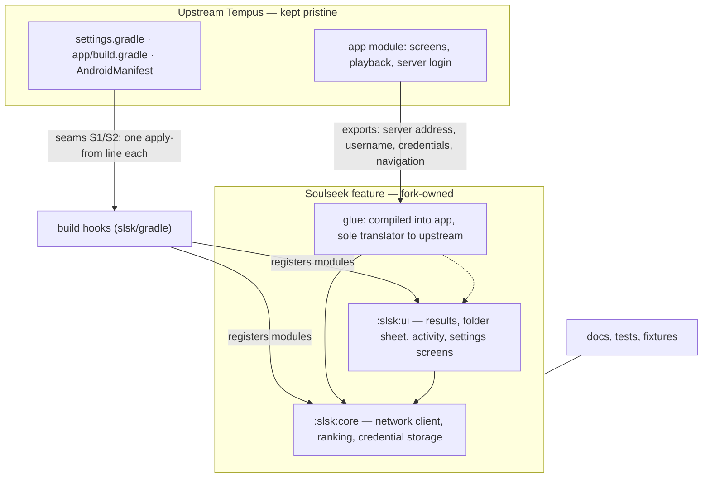
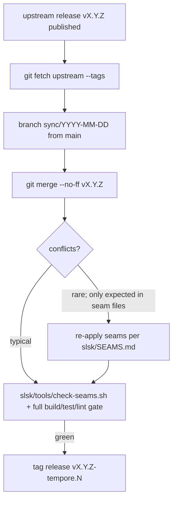

# ARCHITECTURE.md — how Tempore stays mergeable with upstream Tempus

Plain-language overview of the strategy behind this fork: we want upstream's ongoing
improvements to keep flowing into our app **cheaply and safely**, while we build far beyond
what upstream offers (the entire Soulseek/slskd feature). This document explains how we get
both. It assumes no Android or Gradle experience; terms are defined where first used.

---

## 1. The problem in one paragraph

Tempus is an active upstream project: releases land regularly, files move, code gets
refactored. A typical "fork" copies the whole project, changes whatever it likes, and then
drifts — every upstream release becomes a feared manual merge with no map of *our* changes.
Tempore flips that around: we constrain **every** modification we make to upstream files so
the upstream-vs-fork difference stays small, enumerable, and machine-checkable. Upstream
changes then flow in like a routine pull, not open-heart surgery.

## 2. The three rules

1. **New code lives in our own apartments.** All Soulseek functionality (search, downloads,
   settings) sits in self-contained folders (`slsk/core`, `slsk/ui`) that upstream never
   references — upstream only learns they exist through two one-line build hooks
   (seams S1/S2).
2. **When we must touch an upstream file, we do it in tiny, registered places.** Nine
   anchor points (seams S1–S7 + rebrand seams), one to a few lines each, each recorded with
   a text anchor in `slsk/SEAMS.md`.
3. **Everything else we own outright.** Documentation (`PLAN.md`, this file), fork build
   scripts (`slsk/gradle/*`), tests and fixtures live in areas upstream never touches, so
   they can never conflict with upstream changes.

## 3. What "a seam" looks like

A seam is one deliberate line inside an otherwise untouched upstream file:

```groovy
// app/build.gradle: upstream content ends, then a single line loads our build hook.
// This is the ENTIRE change to this file (seam S2).
apply from: '../slsk/gradle/app-hook.gradle'
```

```java
// SearchFragment.java, seam S3: our module may consume the search before upstream logic runs.
public void search(String query) {
    if (SlskSeams.onSearchSubmitted(this, query)) {
        bind.searchView.hide();
        return;
    }
    // upstream logic continues, untouched, below
}
```

Inert if the feature were deleted: every seam is removable without incident.

## 4. How the code is layered



Reading it: upstream files stay nearly pristine; our feature talks to upstream only through a
tiny "glue" translator that is allowed (uniquely) to read upstream state like the Navidrome
server address. Nothing in `slsk/core` or `slsk/ui` may import an upstream class — enforced
by the guard script, so drift can't sneak in.

## 5. Who may reach across the boundary

| From | To | Allowed? |
| --- | --- | --- |
| Any upstream file | `slsk/core`, `slsk/ui` | ❌ never (build blocked on imports) |
| Upstream build files | our build hooks | ✅ only via the S1/S2 one-liners |
| Feature modules | upstream app internals | ✅ only `slsk/app-glue` (the translator) |
| Feature modules | each other | ✅ freely inside `slsk/` |

Whenever an upstream file is modified (seams or rebrand), `slsk/SEAMS.md` records its
location, a text anchor that identifies the joining point, and how to re-apply it after
upstream churn.

## 6. A typical upstream sync



Why this is usually painless: all upstream code sits untouched; our delta outside seams is
≤150 added lines across ≤13 files (tracked by the guard script), so merges and conflicts are
rare and small.

## 7. Where new features go

- Pure Soulseek logic (network, ranking, caching) → `slsk/core`, with unit tests.
- Screens and UI surfaces → `slsk/ui` (resources prefixed `slsk_`).
- Anything needing upstream state (credentials, navigation) → `slsk/app-glue`, kept small.
- General bug fixes that would help upstream too → open a PR against upstream instead of
  patching here; the fix then arrives by sync, shrinking our delta instead of growing it.

## 8. Why this over the alternatives

| Approach | Behavior on upstream updates | Verdict |
| --- | --- | --- |
| Copy the whole repo and edit freely | every sync = hand-reviewing hundreds of diffs | rejected |
| Fork with comment markers on each change | same problem, slightly better annotated | rejected |
| A separate app reusing upstream as a library | upstream isn't structured as a library; still a full copy | rejected |
| **Seam-isolated feature modules (ours)** | sync is routine; total forced attention ≈13 files + guard script | chose this |

## 9. Pointers

- `PLAN.md` — canonical spec: features, decisions, verification gates, development log.
- `slsk/SEAMS.md` — every upstream touch with anchors + re-apply notes; rebrand seams R1–R3.
- `slsk/tools/check-seams.sh` — the automated guard (`≤13 files / ≤150 lines + anchor check`).
- `slsk/SPIKE.md` — live-probed slskd API facts (what we worked around).
- `slsk/core`, `slsk/ui`, `slsk/app-glue` — implementation modules.
- CI caveat: upstream CI is disabled in this repo; the guard runs locally (PLAN.md §3).
